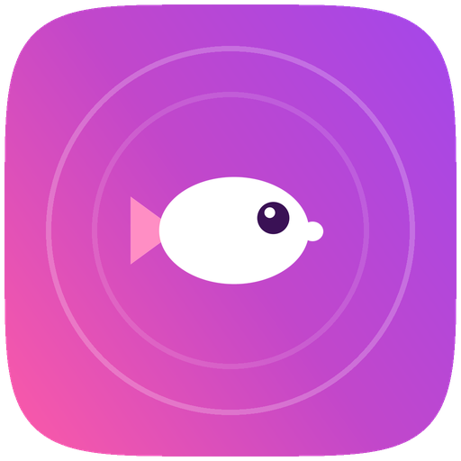

<p align="center">
  
</p>

<h1 align="center">Yap</h1>
<p align="center"><b>Stop typing. Start yapping.</b><br>
A tiny macOS menu-bar app that turns your voice into clean, finished text — anywhere your cursor is.</p>

---

## What it is

Yap lives in your menu bar. Hold a key, talk, let go — Yap sends your recording to an AI model
that **transcribes and formats it in a single step**, then pastes the result wherever you're
typing. It works in any app: email, notes, chat, code comments, anywhere.

It also has a **Rewrite** button: select any text, press the shortcut, and Yap cleans it up in
place.

You bring your **own API key**, and you choose the provider:

- **Google Gemini** — has a **free** tier (no credit card needed)
- **OpenAI** — `gpt-4o`-family audio models

Yap only ever offers models that can take audio directly, so a recording becomes finished text in
**one network call** — there's no separate "transcribe then format" round-trip.

## How it works

1. You hold **Right Option (⌥)** and tap an arrow to pick a "button" (Clean, Summary, Email, …).
2. Yap records while you hold the key.
3. On release, the audio + that button's prompt go over **HTTPS** to your chosen provider.
4. The finished text is pasted at your cursor.

Each button is just an editable prompt, so you can make Yap do whatever you want (translate, draft
an email, make a to-do list). Every built-in button has a **Reset to default** in Settings.

## Requirements

- macOS (Apple Silicon or Intel)
- Python 3.9+ (only to run from source or build the app)
- A free Google Gemini key (or an OpenAI key)

## Install

**Run from source:**

```bash
pip3 install rumps pynput sounddevice numpy requests pyobjc-framework-WebKit pyobjc-framework-AVFoundation
python3 yap.py
```

**Build a double-clickable `Yap.app`:**

```bash
python3 -m venv build-env
source build-env/bin/activate
pip install rumps pynput sounddevice numpy requests pyobjc-framework-WebKit pyobjc-framework-AVFoundation py2app Pillow
pip install --no-binary charset_normalizer charset_normalizer
python setup_app.py py2app          # -> dist/Yap.app
deactivate
```

See [SETUP.md](SETUP.md) for the friendly, step-by-step version.

## Bring your own API key

Yap never ships with a key, and your key never leaves your Mac except to call your chosen provider.

- **Gemini (free):** create a key at <https://aistudio.google.com/apikey> and paste it in onboarding
  or **Settings → Provider & model**.
- **OpenAI:** create a key at <https://platform.openai.com/api-keys>.

Your key is stored only in `~/.yap/config.json` on your machine.

## Permissions (and why each is needed)

macOS asks for three permissions the first time you run Yap. Yap uses them **only** for the
hold-to-talk workflow — nothing else:

| Permission | Why Yap needs it |
|---|---|
| **Microphone** | To record your voice while you hold the shortcut. |
| **Input Monitoring** | To detect the global hold-to-talk hotkey (the arrow chord) while you work in other apps. |
| **Accessibility** | To paste the finished text into the app you're using, and to copy the selected text for the Rewrite button. |

Yap does not read your screen, log your keystrokes, or watch what you type — the key listener only
looks for its own shortcut, and Accessibility is used purely for copy/paste of the current
selection.

> **Note:** granting **Input Monitoring** to an unsigned app only takes effect after you **quit and
> reopen** Yap — the onboarding flow points this out and offers a "Quit & Reopen" button.

## Privacy

- **What leaves your Mac:** only the audio you record while holding the shortcut (and, for the
  Rewrite button, the text you have selected). It is sent over an encrypted **HTTPS** connection to
  the **one** provider you chose — Google Gemini **or** OpenAI — which returns the finished text.
- **What does not leave your Mac:** everything else. Yap has **no accounts, no analytics, no
  telemetry, no tracking**, and makes no other network calls.
- **Your key** is stored only in `~/.yap/config.json` on your machine and is sent solely to your
  chosen provider.
- **Local log:** Yap keeps a small debug log at `~/.yap/yap.log`. It records app events and the
  *length* of results — **never your API key and never your transcribed text**.
- **Provider terms:** the audio/text you send is processed by your provider under their terms.
  See [Google's](https://ai.google.dev/gemini-api/terms) and
  [OpenAI's](https://openai.com/policies/) privacy/API policies.

> **Want extra hardening?** Storing the API key in the **macOS Keychain** instead of a plain JSON
> file would protect it from other local processes that can read your home folder. It's a sensible
> future improvement; today the key lives in `~/.yap/config.json` (readable only by your user
> account).

## Distribution

The built `Yap.app` is **unsigned**. That's fine for personal use, but it means:

- macOS Gatekeeper shows an "unidentified developer" warning on first open (right-click → **Open**
  to get past it), and
- each rebuild resets the three permissions, because macOS sees an unsigned rebuild as a "new" app.

**Recommended before sharing widely:** sign the app with an Apple **Developer ID** and **notarize**
it. That removes the Gatekeeper warning and keeps permissions stable across updates. It needs a paid
Apple Developer account ($99/yr). This is a recommendation, not a blocker — Yap runs fine unsigned.

## Configuration

All settings — provider, model, API keys, and your buttons/prompts — live in `~/.yap/config.json`
and are editable from **Settings** (menu-bar icon → Settings). Nothing about your configuration is
stored in this repository or in the built app.

## License

[MIT](LICENSE) © Federico Zaninelli
